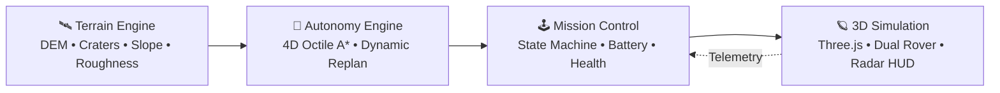

# 🌕 LunaPath-4D — Autonomous Lunar Rover Simulation System

> 🚀 **Live Production Deployment:** **[https://lunapath-4d-iota.vercel.app](https://lunapath-4d-iota.vercel.app)**  
> 📡 **Vercel Project Dashboard:** [https://vercel.com/ys9091729-8074/lunapath-4d](https://vercel.com/ys9091729-8074/lunapath-4d)

---

## 🛰️ Executive Overview

**LunaPath-4D** is an autonomous lunar rover simulation and intelligent terrain navigation platform engineered for extreme lunar polar surface operations (Lunar South Pole, -89.0° S, 0.0° E). 

Planetary exploration near the lunar poles presents unique challenges: permanent shadow traps, elongated low-angle solar rays, steep crater scarps, and untracked boulder clusters. LunaPath-4D solves these through an integrated **4-Tier Aerospace Architecture**:



---

## 🏛️ System Architecture

| Tier / Layer | Key Components | Technical Implementation |
| :--- | :--- | :--- |
| **Tier 1: Terrain & Geostatistics** | `pipeline/` | • Multi-scale Hermite gradient DEM synthesis ($256 \times 256$, 10 m/px)<br/>• Pareto morphometric impact cratering with elevated rims & ejecta<br/>• Horn's 2D gradient slope ($0^\circ - 47^\circ$) & RMS micro-roughness ($R_q$)<br/>• 4-tier traversability classification & zero-copy IEEE 754 `.bin` export |
| **Tier 2: Autonomous Navigation** | `web/navigation/` | • 8-direction Octile distance A\* with multi-objective cost weighting<br/>• 4 operational profiles: `BALANCED`, `SAFEST`, `FASTEST`, `ENERGY_EFFICIENT`<br/>• 40 m forward sensor buffer with real-time mid-mission replanning<br/>• Discrete grid $[0, 255]$ to Three.js continuous world $[X, Z]$ coordinate adapter |
| **Tier 3: 3D Visualization** | `web/src/` | • Physically based lunar regolith rendering with low polar sun shadows<br/>• Pragyan-scale 6-wheel articulated rocker-bogie rover model<br/>• **Ghost Baseline Rover ("Ghost Car")** for side-by-side naive path benchmarks<br/>• 5 false-color overlays (Elevation, Slope, Roughness, Traversability, Normal)<br/>• Follow-Rover, Follow-Ghost, Orbit, Top-Down, and Horizon camera modes |
| **Tier 4: Mission Control** | `web/src/` | • Live telemetry feed (position, elevation, heading, velocity, progress)<br/>• Physical battery model: $P_{total} = P_{avionics} + P_{rolling} + P_{climb} + P_{rough}$<br/>• 4-subsystem health diagnostics (Mobility, Navigation, Power, Comms)<br/>• 2D tactical radar minimap HUD & one-click flight report JSON export |

---

## 🔬 Core Engineering Capabilities

### 1. Scientific Lunar Terrain Synthesis
* **High-Resolution Polar DEM**: Models a $2.56\text{ km} \times 2.56\text{ km}$ polar quadrant at 10 m/cell resolution, spanning elevations from $37.6\text{ m}$ to $165.3\text{ m}$.
* **Procedural Cratering Morphometry**: Primary and secondary impacts governed by power-law Pareto size distributions with parabolic cross-sections, structural rim uplift ($h_{rim} \approx 0.25 d$), and continuous Hermite ejecta blankets.
* **Surface Derivatives**:
  * **Horn's Finite-Difference Slope**: Generates slope matrices isolating impassable grades ($>15^\circ$).
  * **RMS Roughness ($R_q$)**: Evaluates high-frequency terrain standard deviation over moving $5 \times 5$ kernels.
  * **Traversability Mask**: Computes continuous traversability cost ($0.0 = \text{nominal}$, $1.0 = \text{impassable}$).
* **Zero-Copy Binary Streaming**: Data is packed into raw little-endian IEEE 754 32-bit float buffers (`dem.bin`, `slope.bin`, `rough.bin`, `traversability.bin`), enabling direct client-side WebGL memory transfers.

### 2. Autonomous 4D Navigation
* **Continuous Cost Formulation**:
  $$\text{Cost}(u, v) = \text{dist}(u, v) \times \left(1.0 + w_{slope} \cdot S(v) + w_{rough} \cdot R(v) + w_{trav} \cdot T(v)\right)$$
* **Navigation Profiles**:
  * `BALANCED`: Optimal trade-off between mission timeline and terrain stress.
  * `SAFEST`: Strict avoidance of slopes $>10^\circ$ and rock fields.
  * `FASTEST`: Pure minimal-distance traverse across passable territory.
  * `ENERGY_EFFICIENT`: Minimizes mechanical climbing work to preserve battery reserves.
* **Dynamic Mid-Mission Replanning**: Continuously evaluates forward sensor horizons. If an unexpected crater rim or impassable obstacle is encountered, the planner executes a mid-mission replan without restarting the rover state machine.

### 3. Interactive 3D Simulation & Dual-Rover Benchmark
* **Three.js Graphics Pipeline**: Features soft PCF shadows, ACES filmic tone mapping, an airless lunar skybox, and deep space starfield.
* **Dual-Rover Benchmark ("Ghost Car")**:
  * **Primary Rover (`LP-R01 Autonomous 4D`)**: Navigates along the intelligent, hazard-mitigated path.
  * **Ghost Baseline Rover (`LP-G00 Naive Baseline`)**: Concurrently runs a naive slope-only path, visually cutting through high-risk crater scarps to provide instant visual validation of the autonomy pipeline.
* **5 Scientific Inspection Layers**: Real-time switching between Normal Regolith, Hypsometric Elevation, Critical Slope Heatmap ($<5^\circ, 5\text{--}10^\circ, 10\text{--}15^\circ, >15^\circ$), Roughness RMS, and Traversability Cost.
* **2D Tactical Radar Minimap HUD**: Inset radar display displaying topography, crater boundaries, vehicle heading arrows, and route progression.

### 4. Mission Control Systems & Telemetry
* **Physics-Based Energy Modeling**: Real-time Watt-hour depletion factoring in base avionics ($35\text{ W}$), wheel friction, and mechanical potential energy climbing work ($m \cdot g \cdot v \cdot \sin\theta$).
* **Subsystem Health Monitoring**: Continuous status monitoring across Mobility (rocker-bogie joints), Navigation (stereo cameras), Power (solar/battery), and Communications (S-band link budget).
* **Mission Reporting**: Real-time event logging and one-click JSON flight summary export.

---

## ⚡ Quick Start & Deployment

### 🌐 Live Web Simulation
Access the production application directly in any modern WebGL-compatible browser:  
👉 **[https://lunapath-4d-iota.vercel.app](https://lunapath-4d-iota.vercel.app)**

### 💻 Local Setup

#### Prerequisites
* Node.js (v18.0+)
* Python (v3.10+)

```bash
# Clone the repository
git clone https://github.com/Sambhav-2706/LunaPath-4D.git
cd LunaPath-4D

# Install frontend dependencies and launch development server
npm install
npm run dev
```

Open `http://localhost:5173` to view the simulation.

#### Optional: Regenerating Scientific Terrain
```bash
# Setup Python virtual environment
python -m venv .venv
.\.venv\Scripts\Activate.ps1    # Windows (or source .venv/bin/activate on Unix)

# Install scientific dependencies and run generator
pip install -r requirements.txt
python pipeline/pipeline_orchestrator.py

# Run test suite
pytest -v pipeline/
```

---

## 📊 Technical Specifications

| Parameter | Specification |
| :--- | :--- |
| **Target Coordinates** | Lunar South Pole (-89.0° S, 0.0° E) |
| **Grid Extent** | 256 × 256 cells ($2.56\text{ km} \times 2.56\text{ km}$) |
| **Spatial Resolution** | 10.0 m / cell |
| **Elevation Bounds** | 37.6 m to 165.3 m |
| **Max Safe Slope Limit** | 15.0° (critical mechanical climbing threshold) |
| **Vehicle Scale** | Pragyan-class 6-wheel rocker-bogie chassis |
| **Graphics Engine** | Three.js (WebGL, PCF Soft Shadow Maps, ACES Filmic Tone Mapping) |
| **Frame Rate** | 60 FPS target with 1x to 10x time acceleration |
| **Data Format** | Zero-copy IEEE 754 little-endian 32-bit float binaries |

---

## 🛡️ Verification & Test Suite

| Test Suite | Scope | Status |
| :--- | :--- | :--- |
| **Scientific Pipeline Suite** | 69 Unit & Integration Tests (DEM, craters, slope, roughness, traversability, binary serialization) | ✅ 69/69 PASSED (100%) |
| **Autonomous Navigation Suite** | A\* edge cases, cost formulas, hazard detection, dynamic replanning, continuous mission controller | ✅ ALL PASSED |
| **Frontend Production Build** | Vite client compilation, Three.js shader linking, asset packaging | ✅ ZERO ERRORS (619 ms) |
| **Production Cloud Deployment** | Vercel edge distribution, static binary dataset caching, SPA client routing | ✅ LIVE ON VERCEL |
