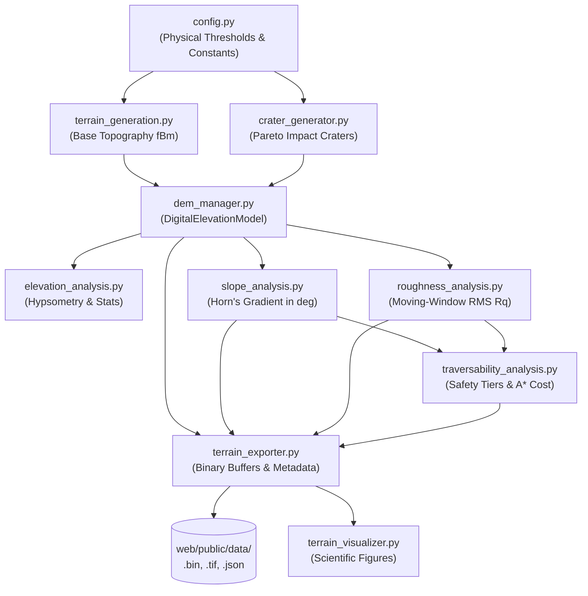
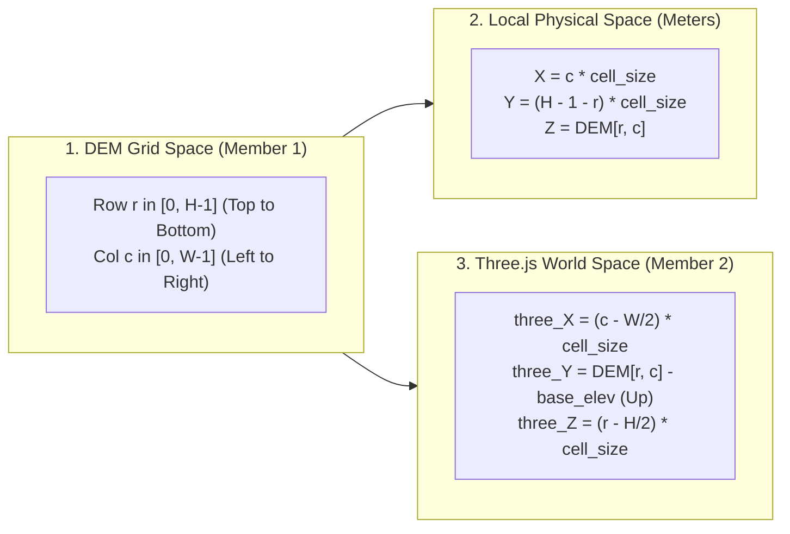

# LunaPath-4D: Terrain & Data Engineering Module Documentation

**Member 1: Topographic Modeling, Geomorphic Analysis & Data Contracts**  
*Mission: Lunar South Pole Autonomous Rover Navigation Simulator*

---

## Table of Contents

1. [Executive Summary & Purpose](#1-executive-summary--purpose)
2. [Scientific Assumptions & Geological Modeling](#2-scientific-assumptions--geological-modeling)
3. [System Architecture & Module Breakdown](#3-system-architecture--module-breakdown)
4. [Python Dependencies & Environment Setup](#4-python-dependencies--environment-setup)
5. [Terrain Generation Quickstart & Pipeline Execution](#5-terrain-generation-quickstart--pipeline-execution)
6. [Crater Generation Mathematics & Morphometry](#6-crater-generation-mathematics--morphometry)
7. [Digital Elevation Model (DEM) Structure](#7-digital-elevation-model-dem-structure)
8. [Elevation Analysis & Hypsometric Statistics](#8-elevation-analysis--hypsometric-statistics)
9. [Slope Calculation Equations](#9-slope-calculation-equations)
10. [Roughness Calculation Methodology](#10-roughness-calculation-methodology)
11. [Traversability & Rover Safety Classification](#11-traversability--rover-safety-classification)
12. [Data Export Formats & Binary Storage](#12-data-export-formats--binary-storage)
13. [Coordinate Systems & Spatial Conventions](#13-coordinate-systems--spatial-conventions)
14. [Team Integration Guide (Member 2 & Member 3)](#14-team-integration-guide-member-2--member-3)
15. [Automated Testing & Performance Benchmarking](#15-automated-testing--performance-benchmarking)
16. [Known Limitations & Future Roadmap](#16-known-limitations--future-roadmap)

---

## 1. Executive Summary & Purpose

The **LunaPath-4D Terrain & Data Engineering Engine** is responsible for synthesizing, analyzing, validating, and formatting high-fidelity topographic datasets of the lunar surface. It provides the physical and spatial foundation for the entire LunaPath-4D simulator.

### Primary Objectives:
- **Synthetic Lunar Surface Generation**: Generate configurable, procedurally authentic lunar terrain featuring multi-scale undulations, impact crater populations, and micro-relief regolith textures.
- **Topographic & Hazard Characterization**: Compute physical terrain derivatives including 2D slope gradients, local surface roughness (RMS height variation), and vertical elevation distributions.
- **Safety & Traversability Assessment**: Classify terrain into 4 discrete safety tiers (SAFE, MODERATE, DIFFICULT, UNSAFE) based on rover operational limits (e.g., Chandrayaan-3 / Pragyan kinematics) and produce continuous navigation cost maps for pathfinding.
- **Multi-Disciplinary Data Contracts**: Package and export high-performance binary memory buffers, GeoTIFF spatial rasters, and JSON metadata schemas for:
  - **Member 2 (Frontend / 3D Visualization)**: Direct GPU buffer streaming in Three.js.
  - **Member 3 (Autonomous Navigation / Pathfinding)**: High-speed matrix access for graph-based path search (A*, D*, RRT*).

---

## 2. Scientific Assumptions & Geological Modeling

> [!IMPORTANT]
> **Synthetic Model Disclaimer**: The terrain generated by this engine is a **mathematical and procedural synthetic approximation** inspired by empirical lunar geomorphology (e.g., McGetchin et al., 1973; Melosh, 1989; Pike, 1977). It is **not measured lunar laser altimetry** (such as NASA LRO LOLA or JAXA SELENE/Kaguya TC). It must not be cited as empirical ground truth.

### Key Scientific Assumptions:
1. **Local Cartesian Tangent Plane**: For a $2.56\,\text{km} \times 2.56\,\text{km}$ operational area, lunar spherical curvature ($R_{\text{Moon}} \approx 1,737.4\,\text{km}$) introduces a maximum vertical deviation of $\Delta h \approx \frac{d^2}{2 R} \approx \frac{(1.81\,\text{km})^2}{2 \times 1737.4\,\text{km}} \approx 0.94\,\text{m}$. For local navigation, a flat Cartesian plane ($X, Y, Z$) is mathematically sound.
2. **Impact Crater Scaling Laws**: Simple lunar craters ($D < 15\,\text{km}$) exhibit characteristic depth-to-diameter ratios ($d/D \approx 0.14 - 0.22$) and rim-height-to-diameter ratios ($h_{\text{rim}}/D \approx 0.035 - 0.055$).
3. **Power-Law Size-Frequency Distribution (CSFD)**: Cumulative crater counts follow a Pareto distribution $N(D) \propto D^{-b}$ where $b \approx 1.8 - 2.0$, reflecting billions of years of impact bombardment saturation.
4. **Continuous Ejecta Blanket Attenuation**: Exterior continuous ejecta decreases with distance following an empirical power law $t(r) \propto (r/R)^{-3.0} \exp(-\gamma (r/R - 1))$, tapering to background regolith at $r \approx 2.5 - 2.8 R$.
5. **Multi-Harmonic Rim Asymmetry**: Natural impact craters deviate from perfect circles due to oblique impact trajectories, target rock jointing, and rim wall slumping.

---

## 3. System Architecture & Module Breakdown

The pipeline is organized into modular Python components under `pipeline/`:

```
LunaPath-4D/pipeline/
├── config.py                     # Central constants, filepaths, thresholds, and seeds
├── terrain_generation.py         # Multi-octave Hermite noise & procedural base generation
├── crater_generator.py           # Impact crater morphometry, Pareto sampling & ejecta blankets
├── dem_manager.py                # DigitalElevationModel object, validation, and GeoTIFF I/O
├── elevation_analysis.py         # Hypsometric statistics, percentiles, relief metrics
├── slope_analysis.py             # 2D gradient calculation via Horn's method & degree conversion
├── roughness_analysis.py         # Moving-window RMS height deviation (Rq) with mean-shifting
├── traversability_analysis.py    # 4-tier safety classification & continuous A* cost mapping
├── terrain_visualizer.py         # Scientific 2D heatmaps, 3D surface mesh rendering
├── terrain_exporter.py           # Zero-copy binary export & versioned contract serialization
├── pipeline_orchestrator.py      # Master unified execution pipeline (Stages 1 through 8)
└── benchmark_performance.py     # Multi-resolution execution profiling (256, 512, 1024)
```

### Module Responsibilities & Interfaces



---

## 4. Python Dependencies & Environment Setup

### Required Packages
The terrain engineering pipeline utilizes scientific Python libraries specified in [requirements.txt](file:///d:/AA/Projects/LunaPath-4D/requirements.txt):

| Package | Minimum Version | Tested Version | Purpose |
| :--- | :--- | :--- | :--- |
| **Python** | `>= 3.10` | `3.12.10` | Base runtime environment |
| **NumPy** | `>= 2.0.0` | `2.2.3` | High-performance vectorized matrix arithmetic |
| **SciPy** | `>= 1.14.0` | `1.15.2` | Spatial convolution filters (`scipy.ndimage`) |
| **Matplotlib** | `>= 3.9.0` | `3.10.0` | Scientific publication figures, 2D/3D visualizations |
| **Rasterio** | `>= 1.3.10` | `1.4.3` | Geospatial raster and GeoTIFF GDAL bindings |
| **Pytest** | `>= 8.0.0` | `9.2.0` | Automated test harness and regression validation |

### Installation Instructions (Windows PowerShell)

```powershell
# 1. Navigate to the repository root
cd d:\AA\Projects\LunaPath-4D

# 2. Initialize a Python virtual environment
python -m venv .venv

# 3. Activate the virtual environment
.\.venv\Scripts\Activate.ps1

# 4. Upgrade pip and install dependencies
python -m pip install --upgrade pip
pip install -r requirements.txt
```

---

## 5. Terrain Generation Quickstart & Pipeline Execution

### Quickstart Execution

To execute the entire 8-stage pipeline using standard configuration parameters ($256 \times 256$ grid, $10.0\,\text{m/cell}$, seed $42$):

```powershell
.\.venv\Scripts\python.exe pipeline\pipeline_orchestrator.py
```

### Python API Execution

The pipeline can be executed programmatically with custom parameters:

```python
from pipeline.pipeline_orchestrator import run_terrain_pipeline

# Run custom high-resolution terrain pipeline
results = run_terrain_pipeline(
    width=512,
    height=512,
    cell_size_meters=5.0,  # 5.0m resolution (2.56km x 2.56km extent)
    seed=101,
    export_dir="web/public/data"
)

dem = results["dem"]
print(f"Elevation span: {dem.elevation.min():.2f}m to {dem.elevation.max():.2f}m")
print(f"Mean slope: {results['slope_metrics']['mean_slope_deg']:.2f} deg")
```

---

## 6. Crater Generation Mathematics & Morphometry

Impact craters are generated using empirical morphometric scaling laws coupled with multi-harmonic boundary perturbations.

### 1. Cumulative Size-Frequency Sampling (Pareto Distribution)
Crater radii $R$ are sampled from a power-law distribution:
$$N(D) \propto D^{-b}$$
Using inverse transform sampling:
$$r = r_{\min} \cdot \left[1 - u \cdot \left(1 - \left(\frac{r_{\min}}{r_{\max}}\right)^b\right)\right]^{-\frac{1}{b}}, \quad u \sim U(0, 1)$$

### 2. Multi-Harmonic Radial Boundary Irregularity
To avoid artificial circular shapes, the boundary radius $R(\theta)$ varies azimuthally:
$$R(\theta) = R_0 \left[1.0 + \varepsilon_2 \cos(2(\theta - \phi_2)) + \varepsilon_3 \sin(3(\theta - \phi_3)) + \varepsilon_4 \cos(4(\theta - \phi_4))\right]$$
- $\varepsilon_2 \in [-0.12, 0.12]$: Ellipticity caused by oblique impact trajectory angles.
- $\varepsilon_3 \in [-0.05, 0.05]$: Rim wall slump scalloping and mass-wasting asymmetry.
- $\varepsilon_4 \in [-0.03, 0.03]$: Polygonal rim facets aligned with pre-existing crustal joints.

### 3. Interior Cavity Bowl Profile ($u = r / R(\theta) \le 1.0$)
The interior bowl combines a parabolic depression with structural rim uplift:
$$z_{\text{bowl}}(u) = -d \left(1.0 - u^2\right) + h_{\text{rim}} u^4$$
- At the center ($u = 0$): $z = -d$ (maximum transient excavation depth).
- At the rim crest ($u = 1.0$): $z = +h_{\text{rim}}$ (raised structural rim peak).

### 4. Continuous Ejecta Blanket ($u > 1.0$)
Ejecta decays via an empirical power-law multiplied by an exponential attenuation term (McGetchin et al., 1973):
$$z_{\text{ejecta}}(u) = h_{\text{rim}} \cdot u^{-3.0} \cdot \exp(-0.8 (u - 1.0)) \cdot S(u)$$
Where $S(u)$ is a smooth $C^1$ cubic Hermite transition fading to 0 over $u \in [2.0, 2.8]$:
$$t = \text{clip}\left(\frac{u - 2.0}{0.8}, 0.0, 1.0\right), \quad S(u) = 1.0 - \left(3t^2 - 2t^3\right)$$
Beyond $u \ge 2.8$, $z_{\text{ejecta}} = 0$, ensuring the far-field terrain background ($r > 3 R$) is undisturbed.

---

## 7. Digital Elevation Model (DEM) Structure

The DEM represents a continuous regular 2D elevation surface encapsulated in the `DigitalElevationModel` class ([dem_manager.py](file:///d:/AA/Projects/LunaPath-4D/pipeline/dem_manager.py)).

### Internal Data Representation:
- **Array Shape**: $(H, W) = (256, 256)$ standard.
- **Data Type**: Single-precision IEEE 754 floating point (`numpy.float32`, little-endian `<f4`).
- **Memory Layout**: C-contiguous row-major (`array.flags.c_contiguous == True`).
- **Units**: Meters above lunar datum ($z = 0.0\,\text{m}$).
- **NoData Value**: Sentinel `-9999.0` (with NaN isolation mask).

### Coordinate Mapping API:
```python
from pipeline.dem_manager import DigitalElevationModel

dem = DigitalElevationModel.load_binary("web/public/data/dem.bin", width=256, height=256, cell_size_meters=10.0)

# Convert grid indices (col, row) to metric world coordinates
world_x, world_y = dem.grid_to_world(col=128, row=128)
print(f"World Position: X={world_x}m, Y={world_y}m, Z={dem.elevation[128, 128]:.2f}m")

# Roundtrip back to grid indices
col, row = dem.world_to_grid(world_x, world_y)
```

---

## 8. Elevation Analysis & Hypsometric Statistics

The hypsometric analysis module ([elevation_analysis.py](file:///d:/AA/Projects/LunaPath-4D/pipeline/elevation_analysis.py)) computes the statistical distribution of vertical terrain relief.

### Calculated Statistical Metrics:
1. **Minimum Elevation ($z_{\min}$)**: Deepest crater cavity floor.
2. **Maximum Elevation ($z_{\max}$)**: Highest crater rim peak or mountain ridge.
3. **Mean Elevation ($\bar{z}$)**: $\bar{z} = \frac{1}{N} \sum_{i=1}^N z_i$.
4. **Median Elevation ($z_{\text{med}}$)**: 50th percentile of valid elevation cells.
5. **Standard Deviation ($\sigma_z$)**: Overall vertical dispersion of the terrain.
6. **Total Relief ($\Delta z$)**: $\Delta z = z_{\max} - z_{\min}$.
7. **Hypsometric Curve**: Cumulative distribution function $A(z) = P(Z \ge z)$, characterizing terrain maturity and erosion state.

---

## 9. Slope Calculation Equations

Topographic slope is computed in [slope_analysis.py](file:///d:/AA/Projects/LunaPath-4D/pipeline/slope_analysis.py) using centered finite differences based on **Horn's method** across both horizontal directions.

### Mathematical Formulation:
For a grid cell at row $i$ and column $j$ with grid cell spacing $\Delta x$ and $\Delta y$:

1. **Directional Elevation Gradients**:
   $$g_x = \frac{\partial z}{\partial x} \approx \frac{z_{i, j+1} - z_{i, j-1}}{2 \Delta x}$$
   $$g_y = \frac{\partial z}{\partial y} \approx \frac{z_{i+1, j} - z_{i-1, j}}{2 \Delta y}$$

2. **Gradient Vector Magnitude**:
   $$|\nabla z| = \sqrt{g_x^2 + g_y^2}$$

3. **Slope Angle in Degrees**:
   $$\theta = \arctan(|\nabla z|) \cdot \frac{180}{\pi}$$

### Boundary & Invalid Cell Handling:
- At array edges ($i=0, i=H-1, j=0, j=W-1$), single-sided forward and backward finite differences are applied:
  $$g_x(j=0) = \frac{z_{i, 1} - z_{i, 0}}{\Delta x}, \quad g_x(j=W-1) = \frac{z_{i, W-1} - z_{i, W-2}}{\Delta x}$$
- Cells marked as NoData or containing NaNs propagate as NaN and are assigned to the `UNSAFE` traversability class.

---

## 10. Roughness Calculation Methodology

Surface roughness measures micro-topographic height variation within a rover's local footprint ($30\,\text{m} - 50\,\text{m}$), implemented in [roughness_analysis.py](file:///d:/AA/Projects/LunaPath-4D/pipeline/roughness_analysis.py).

### Metric Definition: RMS Height Deviation ($R_q$)
Within a moving window of size $K \times K$ cells ($K=3$ default):
$$R_q = \sqrt{\frac{1}{N} \sum_{k=1}^N \left(z_k - \bar{z}_{\text{local}}\right)^2} = \sqrt{E[z^2] - (E[z])^2}$$

### Optimization & Numerical Stability:
In single-precision `float32`, computing $E[z^2] - (E[z])^2$ on raw lunar elevations ($z \approx 120\,\text{m}$) leads to catastrophic cancellation because $120^2 = 14,400$, exceeding the precision of a 24-bit mantissa for small variances ($\Delta z \approx 0.01\,\text{m}$).
- **Mean Shifting**: Before spatial convolution, elevations are centered: $z' = z - \bar{z}_{\text{global}}$.
- This confines $(z')^2 \le 400$, guaranteeing $3 \times 10^{-6}\,\text{m}$ numerical precision in native `float32` and cutting memory consumption in half.

---

## 11. Traversability & Rover Safety Classification

Traversability analysis ([traversability_analysis.py](file:///d:/AA/Projects/LunaPath-4D/pipeline/traversability_analysis.py)) evaluates whether terrain cells can be safely navigated by an autonomous rover with kinematics modeled after Chandrayaan-3 / Pragyan.

### 4-Tier Discrete Safety Classification:

| Class Code | Category | Color | Slope Threshold | Roughness ($R_q$) Threshold | Rover Kinematic Condition |
| :---: | :---: | :---: | :---: | :---: | :--- |
| **0** | **SAFE** | Green | $\theta < 8.0^\circ$ | $R_q < 1.5\,\text{m}$ | Smooth planar regolith; optimal speed and power |
| **1** | **MODERATE** | Yellow | $8.0^\circ \le \theta < 15.0^\circ$ | $1.5\,\text{m} \le R_q < 3.0\,\text{m}$ | Gentle slopes and mild undulations; reduced speed |
| **2** | **DIFFICULT** | Orange | $15.0^\circ \le \theta < 22.0^\circ$ | $3.0\,\text{m} \le R_q < 5.0\,\text{m}$ | Near-critical slope or rocky ejecta; high slippage risk |
| **3** | **UNSAFE** | Red | $\theta \ge 22.0^\circ$ | $R_q \ge 5.0\,\text{m}$ or NoData | Overturning hazard, vertical crater walls; impassable |

### Continuous Navigation Cost Map (For A* / D* Pathfinding)
For pathfinding algorithms requiring continuous cost surfaces, the normalized navigation cost $C(x, y)$ is defined as:
$$C(x, y) = 1.0 + 3.0 \left(\frac{\theta}{\theta_{\max}}\right)^2 + 2.0 \left(\frac{R_q}{R_{\max}}\right)$$
Cells with $\theta \ge 22.0^\circ$ or $R_q \ge 5.0\,\text{m}$ are marked with cost $\infty$ ($10^6$ sentinel obstacle).

---

## 12. Data Export Formats & Binary Storage

All data assets are exported to `web/public/data/` for consumption by Members 2 and 3:

```
web/public/data/
├── dem.bin                    # Raw binary float32 elevation array (256 x 256 x 4 bytes = 262,144 bytes)
├── slope.bin                  # Raw binary float32 slope array in degrees (262,144 bytes)
├── rough.bin                  # Raw binary float32 roughness array in meters (262,144 bytes)
├── traversability.bin         # Raw binary uint8 classified array [0, 1, 2, 3] (65,536 bytes)
├── dem.tif                    # Standard geospatial GeoTIFF raster with local affine transformation
├── meta.json                  # Comprehensive versioned (v2.0.0) contract schema
├── terrain_meta.json          # Backward-compatible metadata contract
└── hazards.json               # Catalog of discrete obstacles and crater coordinates
```

### JSON Metadata Contract Schema (`meta.json`)
```json
{
  "contract_version": "2.0.0",
  "generated_at": "2026-11-22T00:20:53",
  "grid": {
    "width": 256,
    "height": 256,
    "cell_size_meters": 10.0,
    "extent_x_meters": 2560.0,
    "extent_y_meters": 2560.0,
    "orientation": "row-major, top-to-bottom, left-to-right"
  },
  "coordinate_system": {
    "type": "Cartesian Local Topocentric",
    "origin": "Center (0,0) in Three.js world space",
    "axes": {"X": "East", "Y": "Elevation (Up)", "Z": "South"}
  },
  "units": {
    "elevation": "meters",
    "slope": "degrees",
    "roughness": "meters (RMS Rq)"
  },
  "traversability_classes": {
    "0": "SAFE",
    "1": "MODERATE",
    "2": "DIFFICULT",
    "3": "UNSAFE"
  }
}
```

---

## 13. Coordinate Systems & Spatial Conventions

To ensure zero-error integration across the three project members, coordinate systems are mapped as follows:



---

## 14. Team Integration Guide (Member 2 & Member 3)

### Integration with Member 2 (Three.js 3D Visualization)

Member 2 can stream binary buffers directly into `THREE.PlaneGeometry` vertices without parsing string JSON:

```javascript
// web/src/terrainLoader.js
import * as THREE from 'three';

export async function loadTerrainMesh() {
  // 1. Fetch metadata contract
  const metaRes = await fetch('/data/meta.json');
  const meta = await metaRes.json();
  const { width, height, cell_size_meters } = meta.grid;

  // 2. Stream binary elevation buffer (Float32Array)
  const demRes = await fetch('/data/dem.bin');
  const demBuffer = await demRes.arrayBuffer();
  const elevations = new Float32Array(demBuffer);

  // 3. Construct Three.js terrain geometry
  const geometry = new THREE.PlaneGeometry(
    (width - 1) * cell_size_meters,
    (height - 1) * cell_size_meters,
    width - 1,
    height - 1
  );
  geometry.rotateX(-Math.PI / 2); // Orient horizontal (XZ plane)

  // 4. Displace vertices vertically
  const posAttr = geometry.attributes.position;
  for (let i = 0; i < posAttr.count; i++) {
    posAttr.setY(i, elevations[i] - meta.statistics.elevation.mean_elevation_m);
  }
  posAttr.needsUpdate = true;
  geometry.computeVertexNormals();

  const material = new THREE.MeshStandardMaterial({ color: 0x888888, roughness: 0.9 });
  return new THREE.Mesh(geometry, material);
}
```

---

### Integration with Member 3 (Pathfinding & Navigation)

Member 3 can load `traversability.bin` and `slope.bin` into NumPy arrays in under 2 milliseconds:

```python
# pathfinding/route_planner.py
import numpy as np
import json

def load_navigation_grid():
    # 1. Read metadata
    with open("web/public/data/meta.json", "r") as f:
        meta = json.load(f)
    W = meta["grid"]["width"]
    H = meta["grid"]["height"]

    # 2. Load traversability classification grid (uint8)
    # Shape: (256, 256) with values: 0=SAFE, 1=MODERATE, 2=DIFFICULT, 3=UNSAFE
    traversability = np.fromfile("web/public/data/traversability.bin", dtype=np.uint8).reshape((H, W))

    # 3. Load continuous slope grid (float32 degrees)
    slope = np.fromfile("web/public/data/slope.bin", dtype="<f4").reshape((H, W))

    # 4. Construct boolean obstacle mask for A* search
    # Obstacles include all UNSAFE cells (slope >= 22 deg or excessive roughness)
    obstacle_mask = (traversability == 3)

    return traversability, slope, obstacle_mask
```

---

## 15. Automated Testing & Performance Benchmarking

### Running the Full Test Suite (`pytest`)

The Member 1 test suite comprises **69 automated test cases** spanning unit tests, physical bounds checks, numerical invariants, and integration contracts:

```powershell
# Run the complete test suite
.\.venv\Scripts\pytest.exe -v pipeline/

# Run individual test modules
.\.venv\Scripts\pytest.exe -v pipeline/test_comprehensive_suite.py
.\.venv\Scripts\pytest.exe -v pipeline/test_dem.py
.\.venv\Scripts\pytest.exe -v pipeline/test_slope_analysis.py
.\.venv\Scripts\pytest.exe -v pipeline/test_roughness_analysis.py
.\.venv\Scripts\pytest.exe -v pipeline/test_traversability_analysis.py
.\.venv\Scripts\pytest.exe -v pipeline/test_export_integration.py
```

### Running Performance Benchmarks

The benchmark suite evaluates execution speed and peak memory consumption across three grid resolutions:

```powershell
.\.venv\Scripts\python.exe pipeline\benchmark_performance.py
```

#### Verified Benchmark Results:
- **$256 \times 256$ ($65,536$ cells)**: **$53.87\,\text{ms}$** total time | Peak RAM: **$6.31\,\text{MB}$**
- **$512 \times 512$ ($262,144$ cells)**: **$135.51\,\text{ms}$** total time | Peak RAM: **$25.09\,\text{MB}$**
- **$1024 \times 1024$ ($1,048,576$ cells)**: **$465.61\,\text{ms}$** total time | Peak RAM: **$100.22\,\text{MB}$**

---

## 16. Known Limitations & Future Roadmap

### Known Limitations:
1. **Cartesian Geometry**: The engine assumes a flat Cartesian coordinate system, which is accurate for local rover navigation ($< 10\,\text{km}$) but does not account for planetary curvature across continental scales.
2. **Simplified Ray Systems**: Far-field crater ejecta ray patterns are modeled using power-law radial attenuation rather than ballistic ray filament simulation.
3. **Static Illumination**: The module does not calculate real-time solar elevation angles, dynamic shadowed regions (Permanently Shadowed Regions - PSRs), or thermal diurnal variations.
4. **Homogeneous Regolith Cohesion**: Surface roughness is computed geometrically; the model does not simulate variable regolith grain size distributions, sinkage, or wheel-soil terramechanics (reserved for Member 3's rover dynamics).

### Future Roadmap:
- Integration of actual Lunar Reconnaissance Orbiter (LRO) LOLA GeoTIFF elevation rasters.
- Real-time horizon elevation casting for dynamic solar shadow ray tracing.
- Support for quadtree level-of-detail (LOD) tile streaming for multi-kilometer navigation extents.
